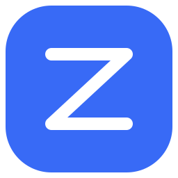

<div align="center">
  
  <h1>NavZip</h1>
  <p><strong>A quieter space for the web.</strong></p>
  <p>An open-source Chromium browser with a minimal interface,<br>flexible tabs and a new tab that belongs to you.</p>
  <p>
    <a href="https://github.com/LuisPeixoto/NavZip/actions/workflows/ci.yml"></a>
    <a href="LICENSE"></a>
    
  </p>
  <p><a href="https://github.com/LuisPeixoto/NavZip/releases">Releases</a> · <a href="docs/GETTING_STARTED.md">Get started</a> · <a href="docs/BUILDING.md">Build</a> · <a href="docs/SCREENSHOTS.md">Screenshots</a> · <a href="CONTRIBUTING.md">Contribute</a> · <a href="docs/ROADMAP.md">Roadmap</a></p>
</div>

<picture>
  <source media="(prefers-color-scheme: dark)" srcset="docs/images/screenshots/new-tab-dark.png">
  
</picture>

> **Experimental developer preview.** NavZip has been built and tested on macOS Intel. There is no qualified, signed Chromium installer yet. Windows, Linux and Apple Silicon browser builds remain unvalidated. [What has been tested →](docs/VALIDATION.md)

## Less interface. More room.

- **Tabs when you need them.** The tab bar disappears with one tab and returns with two. Choose horizontal or vertical tabs.
- **Two pages, one view.** Native split views keep each page's navigation and state.
- **Your own starting point.** A local clock, search and shortcuts you add yourself. No bundled sites, greeting, personal name, city or weather widget.
- **One visual identity.** Graphite and mint in dark mode; quiet, green-accented surfaces in light mode, including Settings.
- **A familiar foundation.** Chromium, Blink and V8, with native browser services and sandboxing preserved.
- **Open development.** C++/Views for the browser, HTML/CSS/TypeScript and Mojo for the new tab, and Rust for development tools, migration and the bounded Wasm helper.

<table>
  <tr>
    <td width="50%"><p align="center"><strong>Horizontal tabs</strong><br>Navigation first. Tabs just below.</p></td>
    <td width="50%"><p align="center"><strong>Vertical tabs</strong><br>A different layout for the same pages.</p></td>
  </tr>
</table>

<sub>Actual macOS captures. The current interface is in Brazilian Portuguese; project documentation and contribution workflows are in English. Historical design concepts are labeled separately in the [gallery](docs/SCREENSHOTS.md).</sub>

## Try the project

For now, NavZip is for developers comfortable building Chromium. End users should wait for a qualified release; an old Alpha installer is **not** the Chromium browser shown here.

```sh
git clone https://github.com/LuisPeixoto/NavZip.git
cd NavZip
cargo xtask doctor
cargo xtask fetch
cargo xtask build
cargo xtask run -- --no-first-run
```

Install the native platform prerequisites first. Initial synchronization requires **at least 120 GiB free**, and builds maintain a 20 GiB reserve; some configurations need more. The Chromium checkout and output stay outside Git. [Complete build guide →](docs/BUILDING.md)

Want to contribute without compiling Chromium?

```sh
cargo test --workspace --locked
cargo clippy --workspace --all-targets --locked -- -D warnings
npm ci --ignore-scripts
npx playwright install --with-deps chromium
npm test
```

On macOS, component tests use an installed Google Chrome unless `NAVZIP_QA_BROWSER` selects another executable. These tests validate the WebUI component; they are distinct from tests of the native NavZip browser.

## Know the boundaries

| Area | Current state |
| --- | --- |
| macOS Intel browser | Native development build; 16 integration checks passed locally |
| Tabs, split view, themes | Exercised in the native browser |
| HTTPS, VP9 video, authenticated downloads, PDF | Covered by the native integration script |
| Chromium extensions | A local MV3 content script tested; Chrome Web Store and broader compatibility pending |
| Private browsing | Cookie isolation and post-close test-marker checks passed; full security audit pending |
| Windows, Linux, macOS Apple Silicon | Build targets planned; browser qualification pending |
| Installers and updates | No qualified installer, production signing or signed updater yet |
| Passwords, printing, real-account web apps | Upstream services retained; complete NavZip validation pending |
| NavZip Wasm extensions | Rust library and isolated worker tested; browser installation UI not integrated |

No memory, speed or battery advantage over Chrome or Brave is claimed without reproducible measurements. NavZip is not affiliated with Google, Brave or the Chromium project.

## Find your way

| For | Start here |
| --- | --- |
| Users and first-time contributors | [Getting started](docs/GETTING_STARTED.md) · [FAQ](docs/FAQ.md) |
| Browser developers | [Build guide](docs/BUILDING.md) · [Architecture](docs/ARCHITECTURE.md) · [Chromium patch workflow](docs/CHROMIUM.md) |
| Designers and UI contributors | [Design](docs/DESIGN.md) · [Screenshot gallery](docs/SCREENSHOTS.md) |
| Test and security contributors | [Validation](docs/VALIDATION.md) · [Security policy](SECURITY.md) · [Release gates](docs/RELEASE.md) |
| Extension authors | [Extension model](docs/EXTENSIONS.md) · [Examples](examples/extensions) |
| Everyone contributing | [Contribution guide](CONTRIBUTING.md) · [Community guidelines](CODE_OF_CONDUCT.md) · [Governance](GOVERNANCE.md) |

## Help shape NavZip

Start with a small, focused contribution: improve a build instruction, reproduce a bug, review accessibility or add a missing regression check. Check [existing issues](https://github.com/LuisPeixoto/NavZip/issues) before proposing work. Use English for issues, pull requests and commits so more people can participate.

Report vulnerabilities privately through the [security policy](SECURITY.md), rather than a public issue.

## License and acknowledgments

NavZip's own code is licensed under [MPL-2.0](LICENSE). Chromium and other dependencies retain their respective licenses and copyright notices; see [third-party notices](THIRD_PARTY_NOTICES.md). Keep those notices with redistributed builds. The project does not ship the proprietary source code or extracted assets of Chrome, Safari or Brave.
