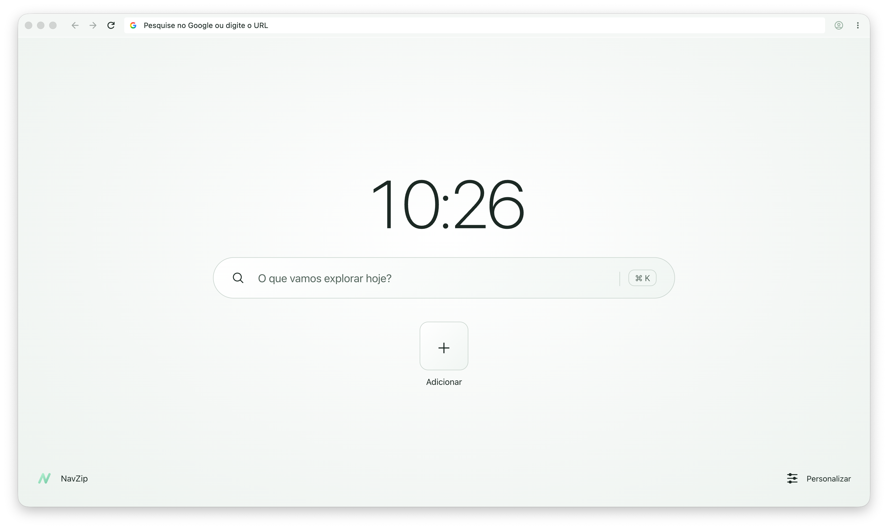
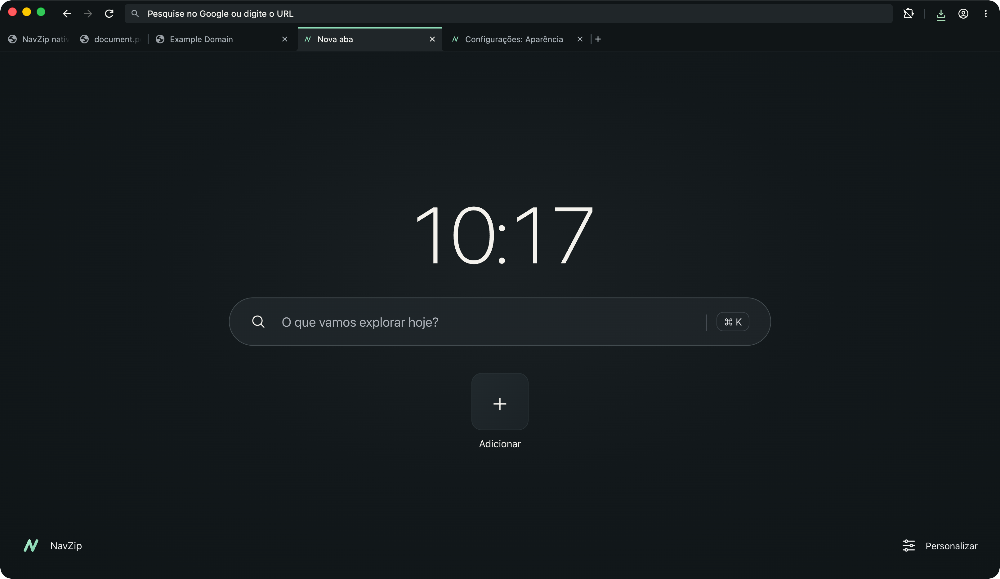
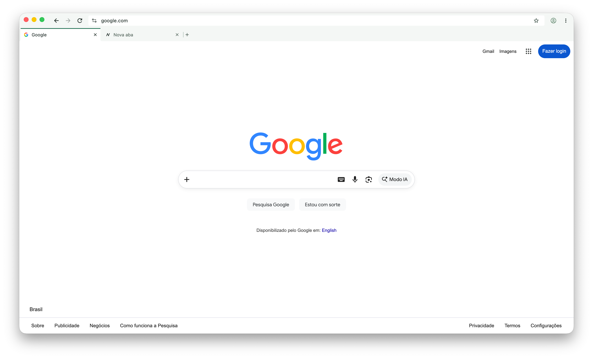
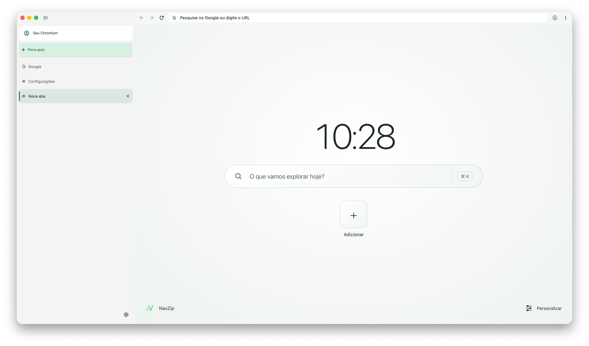
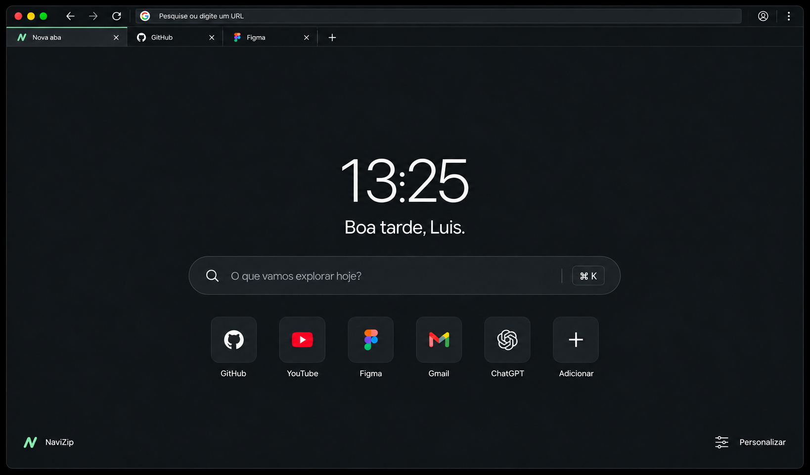
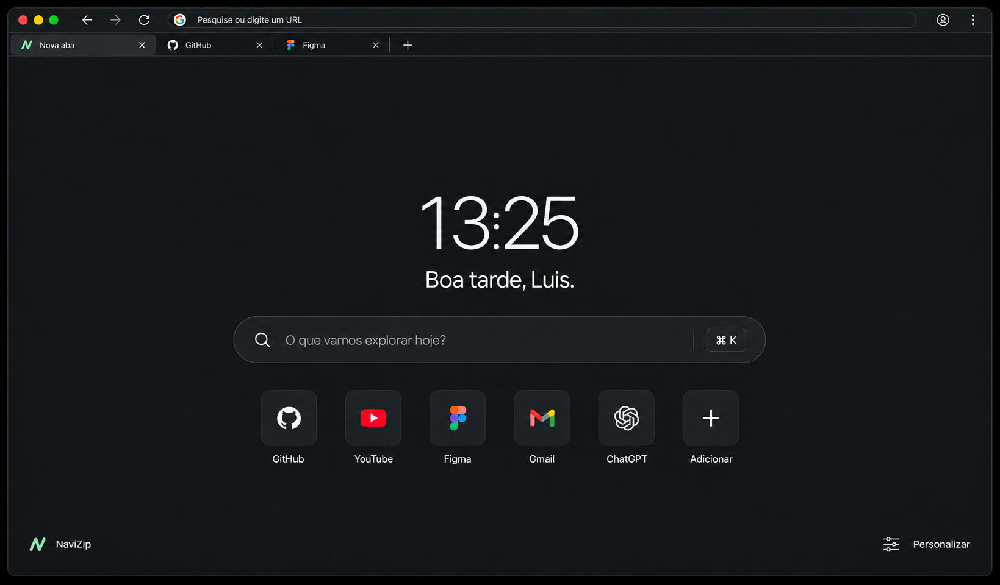

# Screenshot gallery

The first group shows actual NavZip builds. The second preserves design references supplied by the maintainer. Images are copied without retouching; browser chrome, language and profile labels reflect the state at capture time.

## Actual application — macOS, October 19, 2026

### A personal starting point

Maintainer capture at 10:26:04 local time. No greeting, weather or preconfigured sites. Add creates the user's own shortcuts. The interface is currently in Brazilian Portuguese.

### Dark mode

Native app-window capture from the local integration script. The clock is real; this is not a design mockup or a component rendered inside an installed browser.

### Horizontal tabs

Maintainer capture at 10:26:43. The second row appears because there is more than one tab. The Google page and marks belong to their respective owners and do not indicate affiliation.

### Vertical tabs

Maintainer capture at 10:28:37. Native pages remain separate tabs. Profile labels and untranslated upstream strings may still appear in this experimental build.

## Historical design concepts

These supplied images guided the browser frame. **They do not show the current application's complete feature set.** They contain the earlier “NaviZip” spelling, a personal greeting and preset sites that have since been removed. The product name is NavZip.

Refined browser chrome concept

Compact toolbar concept

## Updating this gallery

Use a non-sensitive profile. Do not include credentials, private bookmarks, personal downloads or confidential pages. State the platform, build status and whether an image is native, component-only or conceptual. Do not retouch a screenshot to imply implemented behavior. Screenshots are visual evidence, not proof of browser security or cross-platform qualification.
